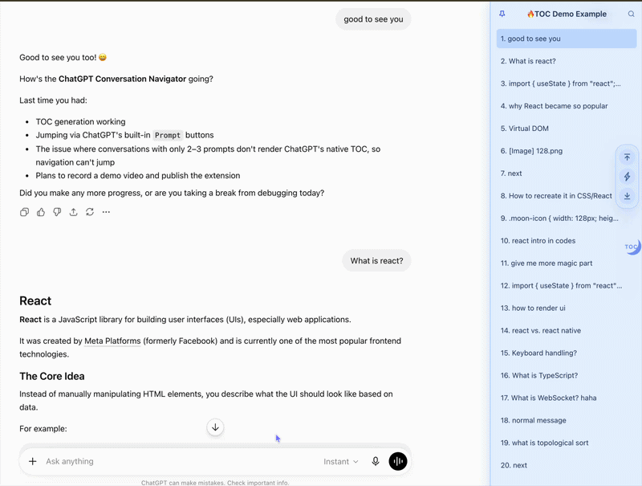

# LunaTOC

一款轻量级 Chrome 浏览器扩展，为 ChatGPT 对话添加**可搜索、可点击的目录（TOC）侧边栏**。

LunaTOC 会自动将你发送的提示词整理成目录，方便快速浏览和定位长对话中的内容。

👉 [从 Chrome 应用商店安装](https://chromewebstore.google.com/detail/chattoc/ibfdglfgljonajofiiaonlimoiolkcpa)

[](https://github.com/Leo7805/chat-toc/releases/latest)



---

## 功能特色

- 根据用户提示词自动生成对话目录
- 展开提示词，浏览对应回答的标题
- 点击目录中的提示词，快速跳转到所在位置
- 标记重要提示词，方便识别
- 搜索和筛选提示词
- 保存并复用自定义提示词模板
- 以可编辑的 Markdown 文件导入或导出已保存的提示词
- 在 ChatGPT 输入框中自动补全已保存的提示词
- 高亮当前可见的提示词
- 鼠标悬停时预览提示词完整内容
- 悬停在侧边栏标题上查看完整对话标题
- 发送新提示词后自动更新目录
- 自由调整侧边栏宽度
- 固定侧边栏，或启用鼠标悬停时展开的自动隐藏模式
- 拖动悬浮开关按钮，并记住当前标签页的位置
- 使用刷新按钮重新生成目录
- 识别文本、图片及文件类型的提示词
- 所有功能均在浏览器本地运行

---

## 安装方法

### 方法一：加载已解压的扩展程序（开发者模式）

1. 下载或克隆此仓库。
2. 安装依赖并构建扩展：

   ```bash
   npm install
   npm run build
   ```

3. 打开 Chrome，在地址栏输入：

   ```text
   chrome://extensions
   ```

4. 开启**开发者模式**。
5. 点击**加载已解压的扩展程序**。
6. 选择构建生成的 `luna-toc/dist` 目录。

---

## 使用方法

1. 打开任意 ChatGPT 对话。
2. 页面右侧会显示 LunaTOC 目录侧边栏。
3. 点击目录项，跳转到对应的提示词。
4. 使用搜索框筛选提示词。
5. 切换到**我的提示词**，管理已保存的提示词模板。
6. 右键点击目录项，将其添加到**我的提示词**。
7. 使用**我的提示词**中的导入和导出按钮，以 Markdown 格式迁移提示词。
8. 在 ChatGPT 输入框中输入 `#` 或 `//`，自动补全已保存的提示词。
9. 将鼠标悬停在被截断的提示词上，查看完整内容。
10. 拖动侧边栏左边缘调整宽度。
11. 使用侧边栏的固定按钮，保持展开或启用自动隐藏。
12. 将鼠标悬停在悬浮按钮上可展开自动隐藏的侧边栏；拖动按钮可调整它在当前标签页的位置。

---

## 为什么选择 LunaTOC？

ChatGPT 对话可能变得很长，查找之前的提问并不方便。LunaTOC 提供轻量级的对话导航功能，帮助你：

- 快速回顾之前的问题
- 浏览较长的技术讨论
- 复查项目规划对话
- 在不同主题之间跳转，而不必反复滚动页面

---

## 技术栈

- TypeScript
- ES Modules
- Vite 和 CRXJS
- Chrome 扩展（Manifest V3）
- DOM 操作
- MutationObserver
- Fetch Hooking
- 服务器发送事件（SSE）

---

## 开发

启动 Vite 开发环境：

```bash
npm run dev
```

构建生产版本扩展，输出到 `dist/`：

```bash
npm run typecheck
npm run build
```

仓库根目录的 `manifest.json` 是扩展清单源文件，Chrome 加载的是生成的 `dist/` 目录。浏览器端源码、Vite 配置和版本发布脚本均使用 TypeScript 编写，并由 `npm run typecheck` 进行类型检查。

---

## 版本管理

原生 npm 版本命令要求 Git 工作区无未提交修改。这些命令会同步 `package.json` 和 `manifest.json` 中的版本号，创建版本提交及对应标签。版本生命周期通过 `tsx` 执行 `scripts/version.ts`，**不会自动推送**提交或标签。

```bash
npm version patch
npm version minor
npm version major
```

---

## 隐私

LunaTOC 完全在浏览器中运行。

扩展不会收集、存储、传输用户对话数据，也不会向任何外部服务共享这些数据。

---

## 许可证

MIT 许可证
