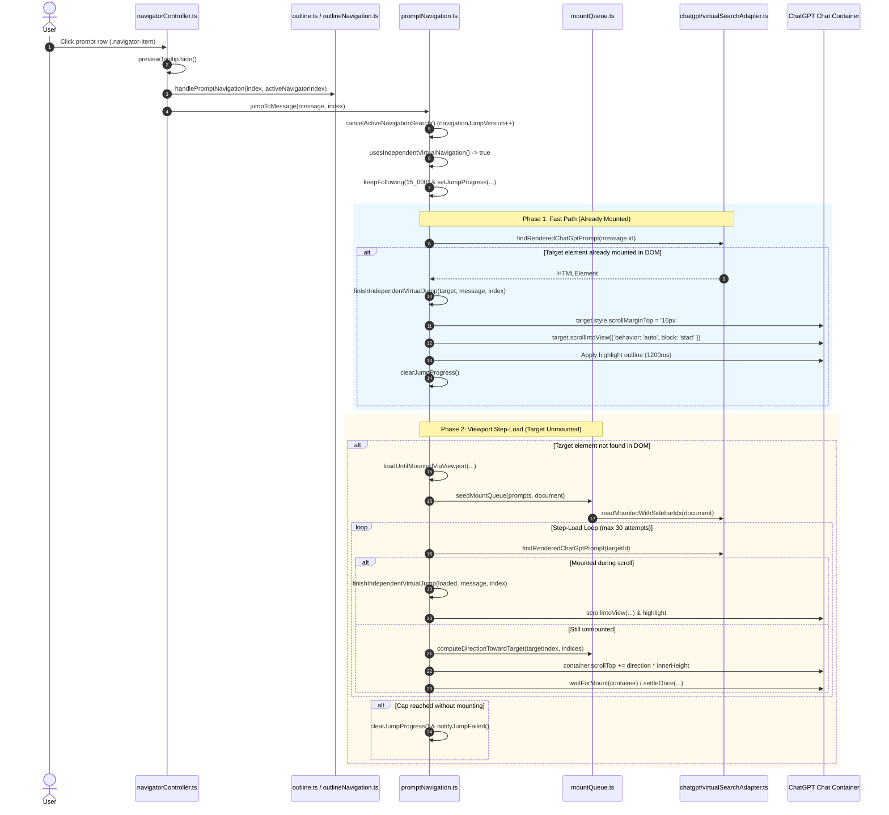
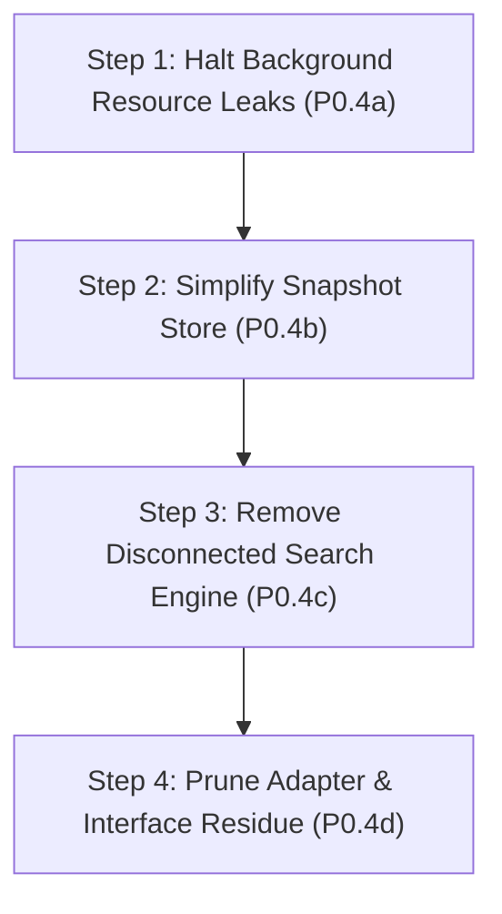

# P0.4 Dead Code and Performance Audit

**Audit Date:** 2026-10-11  
**Target:** Luna TOC Navigation, Virtual Search, Fingerprint, and Anchor-Cache Subsystems  
**Baseline Status:** TypeScript check clean, 40 test files (208/208 tests passing), production build clean.

---

## 1. Executive Summary

This audit investigated the prompt navigation, virtual search, fingerprint matching, and anchor-cache code across Luna TOC to determine what executes in production, what is redundant or genuinely dead, and where unnecessary background work is performed.

### Key Findings

1. **Active Production Navigation Engine:**
   When a user clicks a prompt in the Luna TOC sidebar, navigation executes strictly through `jumpWithIndependentVirtualNavigation()` in [`src/navigation/jump/promptNavigation.ts`](file:///Users/leo/Projects/chrome-plugins/luna-toc/src/navigation/jump/promptNavigation.ts):
   - **Fast Path:** Resolves an already mounted target in the DOM by prompt ID (`findRenderedChatGptPrompt`) or prompt text (`findRenderedChatGptPromptByText`) and scrolls via `scrollIntoView({ behavior: 'auto', block: 'start' })`.
   - **Step-Load Walk:** If unmounted, runs `loadUntilMountedViaViewport()` in [`src/navigation/jump/promptNavigation.ts`](file:///Users/leo/Projects/chrome-plugins/luna-toc/src/navigation/jump/promptNavigation.ts) using `mountQueue.ts` to compute direction (+1 or -1) and scroll the container by `innerHeight` steps while observing DOM mounts with a MutationObserver.
   - If the step-load loop is exhausted after 30 attempts, the jump silently terminates with `notifyJumpFailed()`.

2. **~1,850+ LOC Disconnected Legacy Search Machinery:**
   An entire secondary virtual-search engine—spanning 7 dedicated modules plus parts of `virtualSearchAdapter.ts` and `navigationAnchorStore.ts`—is completely disconnected from runtime navigation:
   - `searchVirtualPrompt` in `virtualSearchController.ts` (704 LOC) has **zero callers** in `src/`.
   - `virtualSearchPlanner.ts` (285 LOC), `relativeSearchPlanner.ts` (162 LOC), and `virtualSearchMachine.ts` (101 LOC) are called exclusively by `virtualSearchController.ts`.
   - `visiblePositionResolver.ts` (269 LOC), `matcher.ts` (220 LOC), and `segmentMatcher.ts` (115 LOC) are only called by `virtualSearchController.ts` and an uncalled adapter wrapper.
   - `navigationAnchorStore.ts` (456 LOC): `createNavigationAnchorStore()` is **never instantiated** anywhere in production runtime.
   - These files exist solely to satisfy their own unit tests.

3. **Continuous Background Performance Leaks:**
   Despite the virtual-search engine being disconnected, the background ingestion pipeline continues running at full throttle:
   - **Continuous DOM MutationObserver & Forced Reflows:** [`src/platforms/chatgpt/renderedFingerprintCollector.ts`](file:///Users/leo/Projects/chrome-plugins/luna-toc/src/platforms/chatgpt/renderedFingerprintCollector.ts) attaches a `MutationObserver` on `document.body` (`subtree: true`, `characterData: true`, `childList: true`). Every token streamed from ChatGPT triggers a 50ms debounced scan of all assistant `.markdown` containers. Reading `.innerText` forces **synchronous browser layout recalculations**.
   - **Unused Web Crypto SHA-256 Hashing:** The collector generates text fingerprints using `crypto.subtle.digest('SHA-256', ...)`. Simultaneously, [`src/navigation/navigatorController.ts`](file:///Users/leo/Projects/chrome-plugins/luna-toc/src/navigation/navigatorController.ts) calls `buildFingerprintIndex` and `buildDerivedSegmentIndex` on every conversation update, computing hundreds of SHA-256 hashes per conversation.
   - **Unconsumed Data Loop:** All generated fingerprints and segments are stored in `navigationSnapshotStore`. **Navigation never reads fingerprintIndex or segmentIndex.** The entire pipeline is an unconsumed closed loop burning CPU, memory, and battery.

---

## 2. Active Navigation Call Graph

The diagram and trace below map the exact production call sequence initiated when a user clicks a prompt in the Luna TOC sidebar.

### 2.1 Sequence Diagram

### 2.2 Trace from Sidebar Click to DOM Scroll

1. **User Interaction:**
   User clicks `.navigator-item` generated in [`navigatorController.ts#L449`](file:///Users/leo/Projects/chrome-plugins/luna-toc/src/navigation/navigatorController.ts#L449).
   Calls `handleNavigatorItemClick(message, index)`:
   - Dismisses tooltip via `previewTooltip.hide()`.
   - Synchronizes outline state via `outlineAction = handlePromptNavigation(index, activeNavigatorIndex)`.
   - Calls `jumpToMessage(message, index)` in [`promptNavigation.ts#L684`](file:///Users/leo/Projects/chrome-plugins/luna-toc/src/navigation/jump/promptNavigation.ts#L684).
   - If outline needs extraction, calls `scheduleBuild(index)`.

2. **Entry Navigation Coordinator (`jumpToMessage`):**
   - Calls `cancelActiveNavigationSearch()`, bumping `navigationJumpVersion` to invalidate any prior in-flight navigation loop.
   - Evaluates `usesIndependentVirtualNavigation()`, which checks `getChatGptNavigationAlgorithm() === 'independent-virtual'`. This returns `true` (the default in `APP_CONFIG.platforms.chatgpt.navigationAlgorithm`).
   - Delegates directly to `jumpWithIndependentVirtualNavigation(message, index)`.
   - *(Note: The legacy-native branch at lines 692–702 is unreachable; its fallback merely logs `JUMP_FALLBACK_LEGACY` and jumps to the top edge).*

3. **Fast Path DOM Resolution:**
   - Obtains `container = getChatGptScrollContainer()` from `virtualSearchAdapter.ts`.
   - Locks auto-follow for 15s via `keepFollowing(15_000)` and publishes progress via `setJumpProgress()`.
   - Queries DOM for target prompt:
     1. Exact ID hit: `findRenderedChatGptPrompt(message.id)` querying `[data-chatgpt-search-message-ids="${id}"]`.
     2. Text hit fallback: `findRenderedChatGptPromptByText(message.text)` querying `[data-chatgpt-search-unit-key$=":user"]` matching prompt text.
   - **If found:** Executes `finishIndependentVirtualJump`:
     - Sets `scrollMarginTop = 16px`.
     - Calls native `target.scrollIntoView({ behavior: 'auto', block: 'start' })`.
     - Injects visual highlight (`2px solid #60a5fa` outline for 1200ms).
     - Clears jump progress. **Navigation complete.**

4. **Step-Load Walk (`loadUntilMountedViaViewport`):**
   - If Fast Path misses, launches asynchronous step-load loop (`promptNavigation.ts#L189-L373`).
   - Seeds queue with currently mounted user messages: `seedMountQueue(prompts, document)` calls `readMountedWithSidebarIdx` to read mounted items and their sidebar indexes.
   - Executes while loop up to `LOAD_HARD_CAP = 30`:
     - Computes step direction via `computeDirectionTowardTarget(targetIndex, sidebarIndices)`: returns `+1` (down) or `-1` (up).
     - Displaces container: `container.scrollTop += direction * innerHeight` (clamped).
     - Synchronizes DOM render via `waitForMount` (`MutationObserver` with debounce).
     - If no new mount observed, runs `settleOnce` (burst 10ms scroll writes followed by MutationObserver wait).
     - On target mount: executes `finishIndependentVirtualJump` (`scrollIntoView` + highlight).
   - **If hard cap exhausted:** Clears jump progress, invokes `notifyJumpFailed()`, and returns. **Does NOT fall back to legacy virtual search.**

5. **Associated Active Navigation Paths:**
   - **Edge Navigation:** User clicks top/bottom buttons in [`jumpToEdgeControls.ts#L111`](file:///Users/leo/Projects/chrome-plugins/luna-toc/src/features/sidebar/jumpToEdgeControls.ts#L111) -> `navigatorController.jumpToAbsoluteEdge(edge)` -> `promptNavigation.ts#jumpToAbsoluteEdge` -> `retryEdgeUntilSettled` (repeatedly writes `scrollTop` to `0` or `scrollHeight`).
   - **Outline Heading Navigation:** User clicks child outline heading in [`outlineNavigation.ts#L33`](file:///Users/leo/Projects/chrome-plugins/luna-toc/src/navigation/jump/outlineNavigation.ts#L33) -> if heading unmounted, calls `jumpToPromptIndex(promptIndex)` in `promptNavigation.ts` (which delegates to `jumpWithIndependentVirtualNavigation` to mount the parent turn) and retries heading location.

---

## 3. Dependency Inventory

The table below catalogs every navigation, search, fingerprint, and anchor module, documenting its stated responsibility, callers, consumers, and actual runtime status.

| Module | LOC | Stated Responsibility | Direct Callers | Data Consumers | Runtime Status |
| :--- | :--- | :--- | :--- | :--- | :--- |
| [`src/navigation/jump/promptNavigation.ts`](file:///Users/leo/Projects/chrome-plugins/luna-toc/src/navigation/jump/promptNavigation.ts) | 1,098 | Main prompt jump coordinator, fast-path resolution, step-load viewport walker, edge jump. | `navigatorController.ts`, `outlineNavigation.ts`, `jumpToEdgeControls.ts` | DOM scroll container, sidebar status, visual outline | **Actively executed production code** (contains small dead branches: unused `jumpToConversationEdge`, dead fallback branch). |
| [`src/navigation/jump/mountQueue.ts`](file:///Users/leo/Projects/chrome-plugins/luna-toc/src/navigation/jump/mountQueue.ts) | 126 | Tracks mounted prompt queue and computes step direction (+1 / -1) toward target. | `promptNavigation.ts` | `loadUntilMountedViaViewport` | **Actively executed production code**. |
| [`src/navigation/jump/outline.ts`](file:///Users/leo/Projects/chrome-plugins/luna-toc/src/navigation/jump/outline.ts) | 919 | Markdown heading extraction, outline accordion rendering, sidebar status indicator. | `navigatorController.ts` | Sidebar DOM | **Actively executed production code**. |
| [`src/navigation/jump/outlineNavigation.ts`](file:///Users/leo/Projects/chrome-plugins/luna-toc/src/navigation/jump/outlineNavigation.ts) | 142 | Navigates to assistant answer headings; restores unmounted parent prompt if needed. | `outline.ts` | DOM scroll container | **Actively executed production code**. |
| [`src/navigation/follow/follow.ts`](file:///Users/leo/Projects/chrome-plugins/luna-toc/src/navigation/follow/follow.ts) | 100 | Coordinates scroll follow-mode locks during jumps. | `navigatorController.ts`, `promptNavigation.ts` | Follow observer | **Actively executed production code**. |
| [`src/navigation/navigationSettings.ts`](file:///Users/leo/Projects/chrome-plugins/luna-toc/src/navigation/navigationSettings.ts) | 93 | Persists navigation algorithm preference in `chrome.storage.local`. | `applicationShell.ts`, `promptNavigation.ts` | `usesIndependentVirtualNavigation` | **Active production code** (configuration key exists, but setting `'legacy-native'` executes top-edge fallback). |
| [`src/navigation/jump/virtualSearchController.ts`](file:///Users/leo/Projects/chrome-plugins/luna-toc/src/navigation/jump/virtualSearchController.ts) | 704 | Iterative virtual list search loop (`searchVirtualPrompt`), wait-for-render, and distance calculations. | Only unit tests (`virtualSearchController.test.ts`) | None | **100% Dead Code**. Zero production callers in `src/`. |
| [`src/navigation/jump/virtualSearchPlanner.ts`](file:///Users/leo/Projects/chrome-plugins/luna-toc/src/navigation/jump/virtualSearchPlanner.ts) | 285 | Absolute position planning, initial anchor estimation, recovery plan. | `virtualSearchController.ts`, unit tests | `virtualSearchController.ts` | **100% Dead Code**. Only called by dead search controller. |
| [`src/navigation/jump/relativeSearchPlanner.ts`](file:///Users/leo/Projects/chrome-plugins/luna-toc/src/navigation/jump/relativeSearchPlanner.ts) | 162 | Relative scroll step planning, learned pixels-per-prompt, crossing reversal. | `virtualSearchController.ts`, unit tests | `virtualSearchController.ts` | **100% Dead Code**. Only called by dead search controller. |
| [`src/navigation/jump/virtualSearchMachine.ts`](file:///Users/leo/Projects/chrome-plugins/luna-toc/src/navigation/jump/virtualSearchMachine.ts) | 101 | Search phase state machine (`initial-estimate`, `seek-response`, `mount-prompt`). | `virtualSearchController.ts`, unit tests | `virtualSearchController.ts` | **100% Dead Code**. Only called by dead search controller. |
| [`src/navigation/jump/visiblePositionResolver.ts`](file:///Users/leo/Projects/chrome-plugins/luna-toc/src/navigation/jump/visiblePositionResolver.ts) | 269 | Resolves visible prompt index from mounted blocks, fingerprints, and segments. | `virtualSearchController.ts`, `virtualSearchAdapter.ts` (dead method), unit tests | None | **100% Dead Code**. Zero active production callers. |
| [`src/navigation/jump/navigationAnchorStore.ts`](file:///Users/leo/Projects/chrome-plugins/luna-toc/src/navigation/jump/navigationAnchorStore.ts) | 456 | LRU store for observed and confirmed navigation anchors in memory and `chrome.storage.local`. | Unit tests; `createNavigationAnchor` in dead adapter method | None | **100% Dead Code**. Store is never instantiated in production runtime. |
| [`src/navigation/jump/navigationSnapshotStore.ts`](file:///Users/leo/Projects/chrome-plugins/luna-toc/src/navigation/jump/navigationSnapshotStore.ts) | 254 | Manages conversation snapshots (prompts, fingerprints, segments). | `navigatorController.ts` | Only `snapshot.prompts` read by `getCachedConversationMessages` | **Partially Active**. Fingerprint and segment tracking is dead overhead; prompt cache is active. |
| [`src/navigation/fingerprint/comparableText.ts`](file:///Users/leo/Projects/chrome-plugins/luna-toc/src/navigation/fingerprint/comparableText.ts) | 45 | Strips Markdown payloads and normalizes text for comparison. | `generator.ts`, `matcher.ts`, `segments.ts`, `renderedFingerprintCollector.ts` | Fingerprint generators | **Active background dependency** (part of unused fingerprint pipeline; no live navigation consumer). |
| [`src/navigation/fingerprint/generator.ts`](file:///Users/leo/Projects/chrome-plugins/luna-toc/src/navigation/fingerprint/generator.ts) | 108 | Computes sample offsets and SHA-256 hashes (`createSha256`). | `index.ts`, `segments.ts`, `renderedFingerprintCollector.ts` | Snapshot store | **Active background CPU sink**; results are never consumed by navigation. |
| [`src/navigation/fingerprint/index.ts`](file:///Users/leo/Projects/chrome-plugins/luna-toc/src/navigation/fingerprint/index.ts) | 172 | Generates derived fingerprint index from raw turns (`buildFingerprintIndex`). | `navigatorController.ts#L729`, unit tests | Snapshot store | **Active background CPU sink**; stored fingerprints are never consumed by navigation. |
| [`src/navigation/fingerprint/segments.ts`](file:///Users/leo/Projects/chrome-plugins/luna-toc/src/navigation/fingerprint/segments.ts) | 615 | Splits responses into derived viewport segments and hashes them. | `navigatorController.ts#L744`, unit tests | Snapshot store | **Active background CPU sink**; stored segments are never consumed by navigation. |
| [`src/navigation/fingerprint/matcher.ts`](file:///Users/leo/Projects/chrome-plugins/luna-toc/src/navigation/fingerprint/matcher.ts) | 220 | Matches visible text blocks against fingerprint index. | Only `visiblePositionResolver.ts`, unit tests | None | **100% Dead Code**. Only called by dead position resolver. |
| [`src/navigation/fingerprint/segmentMatcher.ts`](file:///Users/leo/Projects/chrome-plugins/luna-toc/src/navigation/fingerprint/segmentMatcher.ts) | 115 | Matches viewport text samples against segment index. | Only `visiblePositionResolver.ts`, unit tests | None | **100% Dead Code**. Only called by dead position resolver. |
| [`src/platforms/chatgpt/renderedFingerprintCollector.ts`](file:///Users/leo/Projects/chrome-plugins/luna-toc/src/platforms/chatgpt/renderedFingerprintCollector.ts) | 130 | Observes `document.body` via `MutationObserver` and generates observed SHA-256 fingerprints. | `navigatorController.ts` | Snapshot store | **Active Background Leak**. Runs continuously on `document.body`; output never consumed. |
| [`src/platforms/chatgpt/renderedTextAdapter.ts`](file:///Users/leo/Projects/chrome-plugins/luna-toc/src/platforms/chatgpt/renderedTextAdapter.ts) | 157 | Queries assistant Markdown blocks and reads `.innerText`. | `renderedFingerprintCollector.ts`, `virtualSearchAdapter.ts` | `renderedFingerprintCollector.ts` | **Active Background Leak**. Causes synchronous layout thrashing via `.innerText`. |
| [`src/platforms/chatgpt/virtualSearchAdapter.ts`](file:///Users/leo/Projects/chrome-plugins/luna-toc/src/platforms/chatgpt/virtualSearchAdapter.ts) | 566 | DOM and scroll adaptation for ChatGPT. | `promptNavigation.ts`, `mountQueue.ts`, `platforms/chatgpt/index.ts` | Navigation engine | **Mixed:** Active DOM methods (`getChatGptScrollContainer`, `findRenderedChatGptPrompt`, `readMountedWithSidebarIdx`); dead methods (`observeChatGptVirtualPosition`, etc.). |
| [`src/platforms/chatgpt/nativePromptNavigation.ts`](file:///Users/leo/Projects/chrome-plugins/luna-toc/src/platforms/chatgpt/nativePromptNavigation.ts) | 92 | Native button selectors and user-message observer wrapper. | `platforms/chatgpt/index.ts` | None | **Dead / Redundant**. Exported wrapper methods are not called by `src/` (navigatorController defines its own observer). |
| [`src/platforms/chatgpt/navigationDiagnostics.ts`](file:///Users/leo/Projects/chrome-plugins/luna-toc/src/platforms/chatgpt/navigationDiagnostics.ts) | 139 | Navigation event logging and test config overrides. | `promptNavigation.ts`, `platforms/chatgpt/index.ts` | Console / localStorage | **Mixed:** Logging functions active; `getChatGptNavigationTestConfig` is dead. |

---

## 4. Dead Code Candidates

Every candidate below has been verified through whole-repository AST and grep analysis.

### 4.1 Confirmed Dead Code

These modules and functions have **zero production callers** and are completely decoupled from user-facing features:

1. **[`src/navigation/jump/virtualSearchController.ts`](file:///Users/leo/Projects/chrome-plugins/luna-toc/src/navigation/jump/virtualSearchController.ts) (Lines 1–704, 704 LOC)**
   - *Status:* **Confirmed dead**.
   - *Evidence:* Exports `searchVirtualPrompt`, `waitForVirtualRender`, `searchState`. Not imported or called by any production file in `src/`. Only imported by `test/navigation/jump/virtualSearchController.test.ts`.

2. **[`src/navigation/jump/virtualSearchPlanner.ts`](file:///Users/leo/Projects/chrome-plugins/luna-toc/src/navigation/jump/virtualSearchPlanner.ts) (Lines 1–285, 285 LOC)**
   - *Status:* **Confirmed dead**.
   - *Evidence:* Exports `createInitialSearchPlan`, `createStepPlan`, `createRecoveryPlan`. Called only by `virtualSearchController.ts` and `test/navigation/jump/virtualSearchPlanner.test.ts`.

3. **[`src/navigation/jump/relativeSearchPlanner.ts`](file:///Users/leo/Projects/chrome-plugins/luna-toc/src/navigation/jump/relativeSearchPlanner.ts) (Lines 1–162, 162 LOC)**
   - *Status:* **Confirmed dead**.
   - *Evidence:* Exports `createRelativeSearchPlan`, `createAdaptiveStepSize`. Called only by `virtualSearchController.ts` and `test/navigation/jump/relativeSearchPlanner.test.ts`.

4. **[`src/navigation/jump/virtualSearchMachine.ts`](file:///Users/leo/Projects/chrome-plugins/luna-toc/src/navigation/jump/virtualSearchMachine.ts) (Lines 1–101, 101 LOC)**
   - *Status:* **Confirmed dead**.
   - *Evidence:* Exports `createVirtualSearchMachine`. Called only by `virtualSearchController.ts` and `test/navigation/jump/virtualSearchMachine.test.ts`.

5. **[`src/navigation/jump/visiblePositionResolver.ts`](file:///Users/leo/Projects/chrome-plugins/luna-toc/src/navigation/jump/visiblePositionResolver.ts) (Lines 1–269, 269 LOC)**
   - *Status:* **Confirmed dead in production**.
   - *Evidence:* Exports `resolveVisiblePromptPosition`, `resolveVisibleSegmentPosition`, `resolvePromptIndexesFromIds`. Called only by `virtualSearchController.ts`, `observeChatGptVirtualPosition` in `virtualSearchAdapter.ts` (itself dead), and unit tests.

6. **[`src/navigation/jump/navigationAnchorStore.ts`](file:///Users/leo/Projects/chrome-plugins/luna-toc/src/navigation/jump/navigationAnchorStore.ts) (Lines 1–456, 456 LOC)**
   - *Status:* **Confirmed dead in production**.
   - *Evidence:* Exports `createNavigationAnchorStore`, `createChromeNavigationAnchorStorage`, `createNavigationAnchor`. `createNavigationAnchorStore()` is **never called anywhere in `src/`**. Only referenced in unit tests.

7. **[`src/navigation/fingerprint/matcher.ts`](file:///Users/leo/Projects/chrome-plugins/luna-toc/src/navigation/fingerprint/matcher.ts) (Lines 1–220, 220 LOC)**
   - *Status:* **Confirmed dead**.
   - *Evidence:* Exports `matchFingerprintBlocks`, `findBestMatchingPromptIndex`. Imported only by `visiblePositionResolver.ts` (dead) and unit tests.

8. **[`src/navigation/fingerprint/segmentMatcher.ts`](file:///Users/leo/Projects/chrome-plugins/luna-toc/src/navigation/fingerprint/segmentMatcher.ts) (Lines 1–115, 115 LOC)**
   - *Status:* **Confirmed dead**.
   - *Evidence:* Exports `matchObservedSegments`. Imported only by `visiblePositionResolver.ts` (dead) and unit tests.

9. **Dead Methods in [`src/platforms/chatgpt/virtualSearchAdapter.ts`](file:///Users/leo/Projects/chrome-plugins/luna-toc/src/platforms/chatgpt/virtualSearchAdapter.ts):**
   - `observeChatGptVirtualPosition` ([Lines 347–458](file:///Users/leo/Projects/chrome-plugins/luna-toc/src/platforms/chatgpt/virtualSearchAdapter.ts#L347-L458), 112 LOC): mapped to `platform.navigation.observeVirtualPosition`; zero callers in `src/`.
   - `createChatGptElementNavigationAnchor` ([Lines 462–491](file:///Users/leo/Projects/chrome-plugins/luna-toc/src/platforms/chatgpt/virtualSearchAdapter.ts#L462-L491), 30 LOC): mapped to `platform.navigation.createElementNavigationAnchor`; called only by `observeChatGptVirtualPosition`.
   - `getChatGptScrollMetrics` ([Lines 212–227](file:///Users/leo/Projects/chrome-plugins/luna-toc/src/platforms/chatgpt/virtualSearchAdapter.ts#L212-L227), 16 LOC): mapped to `platform.navigation.getScrollMetrics`; called only by `virtualSearchController.ts`.
   - `getChatGptPromptMountDiagnostic` ([Lines 229–281](file:///Users/leo/Projects/chrome-plugins/luna-toc/src/platforms/chatgpt/virtualSearchAdapter.ts#L229-L281), 53 LOC): mapped to `platform.navigation.getPromptMountDiagnostic`; zero callers in `src/`.
   - `isChatGptElementVisible` ([Lines 170–184](file:///Users/leo/Projects/chrome-plugins/luna-toc/src/platforms/chatgpt/virtualSearchAdapter.ts#L170-L184), 15 LOC): mapped to `platform.navigation.isElementVisible`; zero callers in `src/`.
   - `resolveVisiblePromptPositionByUserMessageId` ([Lines 323–334](file:///Users/leo/Projects/chrome-plugins/luna-toc/src/platforms/chatgpt/virtualSearchAdapter.ts#L323-L334), 12 LOC): private helper; called only by `observeChatGptVirtualPosition`.

10. **Dead Methods in [`src/platforms/chatgpt/nativePromptNavigation.ts`](file:///Users/leo/Projects/chrome-plugins/luna-toc/src/platforms/chatgpt/nativePromptNavigation.ts):**
    - `getNativePromptButtonSelectors` ([Lines 17–19](file:///Users/leo/Projects/chrome-plugins/luna-toc/src/platforms/chatgpt/nativePromptNavigation.ts#L17-L19)): zero callers in `src/`.
    - `getNativePromptIndex` ([Lines 26–33](file:///Users/leo/Projects/chrome-plugins/luna-toc/src/platforms/chatgpt/nativePromptNavigation.ts#L26-L33)): zero callers in `src/`.
    - `getJumpTargetElement` ([Lines 69–92](file:///Users/leo/Projects/chrome-plugins/luna-toc/src/platforms/chatgpt/nativePromptNavigation.ts#L69-L92)): zero callers in `src/`.
    - `observeVisibleUserMessages` ([Lines 40–63](file:///Users/leo/Projects/chrome-plugins/luna-toc/src/platforms/chatgpt/nativePromptNavigation.ts#L40-L63)): zero callers in `src/` because `navigatorController.ts` defines its own copy.

11. **Dead Method in [`src/platforms/chatgpt/navigationDiagnostics.ts`](file:///Users/leo/Projects/chrome-plugins/luna-toc/src/platforms/chatgpt/navigationDiagnostics.ts):**
    - `getChatGptNavigationTestConfig` ([Lines 41–99](file:///Users/leo/Projects/chrome-plugins/luna-toc/src/platforms/chatgpt/navigationDiagnostics.ts#L41-L99)): reads `chatTocTestNavigation` from localStorage to tune virtual search. Zero callers in `src/`.

12. **Dead Branch in [`src/navigation/jump/promptNavigation.ts`](file:///Users/leo/Projects/chrome-plugins/luna-toc/src/navigation/jump/promptNavigation.ts):**
    - `JUMP_FALLBACK_LEGACY` branch ([Lines 692–702](file:///Users/leo/Projects/chrome-plugins/luna-toc/src/navigation/jump/promptNavigation.ts#L692-L702)): unreachable under default settings; fallback merely calls `jumpToAbsoluteEdge('top', 'auto')`.

---

### 4.2 Likely Redundant Code (Unused Runtime Background Work)

These modules run actively in production, but their results are **never consumed** by any active feature:

1. **`renderedFingerprintCollector.ts` ([Lines 1–130](file:///Users/leo/Projects/chrome-plugins/luna-toc/src/platforms/chatgpt/renderedFingerprintCollector.ts#L1-L130), 130 LOC):**
   - *Status:* **Likely redundant background leak**.
   - *Evidence:* Attaches `MutationObserver` to `document.body` and hashes assistant DOM text. Stores records into `navigationSnapshotStore.fingerprintIndex`. Navigation **never reads this index**.

2. **`buildFingerprintIndex` in [`src/navigation/fingerprint/index.ts`](file:///Users/leo/Projects/chrome-plugins/luna-toc/src/navigation/fingerprint/index.ts) (172 LOC) and `buildDerivedSegmentIndex` in [`src/navigation/fingerprint/segments.ts`](file:///Users/leo/Projects/chrome-plugins/luna-toc/src/navigation/fingerprint/segments.ts) (615 LOC):**
   - *Status:* **Likely redundant background leak**.
   - *Evidence:* Invoked in `navigatorController.ts#L729, L744` on every conversation update. Populates `navigationSnapshotStore.segmentIndex` and `fingerprintIndex`, which have zero consumers.

3. **Snapshot Fingerprint/Segment State in [`src/navigation/jump/navigationSnapshotStore.ts`](file:///Users/leo/Projects/chrome-plugins/luna-toc/src/navigation/jump/navigationSnapshotStore.ts):**
   - *Status:* **Likely redundant**.
   - *Evidence:* `completeSegmentIndex`, `upsertSnapshotResponseSegments`, `completeFingerprintIndex`, `upsertFingerprintRecord`, `cloneFingerprintIndex`, `cloneSegmentIndex` maintain and deep-clone data structures that are never read. Only `replacePrompts` and `getSnapshot()?.prompts` are actively consumed.

4. **`jumpToConversationEdge` in [`src/navigation/jump/promptNavigation.ts#L593-L612`](file:///Users/leo/Projects/chrome-plugins/luna-toc/src/navigation/jump/promptNavigation.ts#L593-L612):**
   - *Status:* **Likely redundant**.
   - *Evidence:* Exported from `promptNavigation.ts` and imported in `navigatorController.ts#L46`, but **never called**. Edge jumps on the sidebar invoke `jumpToAbsoluteEdge` directly.

---

### 4.3 Still Required Code

These modules are essential for live production operation and must not be altered during cleanup:

1. **`promptNavigation.ts`:** `jumpToMessage`, `jumpWithIndependentVirtualNavigation`, `loadUntilMountedViaViewport`, `finishIndependentVirtualJump`, `jumpToAbsoluteEdge`, `retryEdgeUntilSettled`, `jumpToPromptIndex`, `lockPromptIndex`.
2. **`mountQueue.ts`:** `seedMountQueue`, `computeDirectionTowardTarget`, `detectNewMounts`, `findTargetInQueue`.
3. **`virtualSearchAdapter.ts` (Active Subset):** `getChatGptScrollContainer`, `getChatGptThreadScrollContainer`, `findRenderedChatGptPrompt`, `findRenderedChatGptPromptByText`, `readMountedWithSidebarIdx`.
4. **`outline.ts` & `outlineNavigation.ts`:** Markdown heading extraction, accordion rendering, child heading jumping.
5. **`follow.ts`:** Auto-follow suspension during user jumps.
6. **`navigationSnapshotStore.ts` (Prompt Subset):** `replacePrompts`, `getSnapshot(key)?.prompts`, `copySnapshot` (used by `getCachedConversationMessages` during route switching).

---

### 4.4 Requires Further Investigation

1. **`src/navigation/navigationSettings.ts` (`chatgpt: 'legacy-native'` vs `'independent-virtual'`):**
   - *Observation:* The settings store reads and synchronizes `chatToc:navigationSettings`. However, setting the value to `'legacy-native'` no longer activates ChatGPT's native TOC buttons (that code was removed, falling through to a top-edge jump).
   - *Investigation:* Confirm whether the user desires preserving the settings schema for potential future platforms, or whether the setting can be simplified to a single active mode.

2. **Duplicate `observeVisibleUserMessages` implementation in `navigatorController.ts` vs `nativePromptNavigation.ts`:**
   - *Observation:* `navigatorController.ts` defines its own internal `observeVisibleUserMessages()` closure using `[data-chatgpt-search-unit-key$=":user"]`, while `nativePromptNavigation.ts` exports an identical function that is never called.
   - *Investigation:* During Task P1.1 / P1.2, this logic will be unified into `platform.config.selectors`.

---

## 5. Background Performance Costs

The audit identified three major continuous background costs executing on every ChatGPT conversation tab:

### 5.1 Continuous DOM MutationObserver and Forced Reflows

- **Origin:** [`src/platforms/chatgpt/renderedFingerprintCollector.ts`](file:///Users/leo/Projects/chrome-plugins/luna-toc/src/platforms/chatgpt/renderedFingerprintCollector.ts#L98-L108).
- **Trigger:** Attached to `document.body` with `{ characterData: true, childList: true, subtree: true }`.
- **Frequency:** Every DOM change on the host page. During ChatGPT response streaming, this fires dozens of times per second. Sidebar UI re-renders and hover states also trigger it.
- **Cost Details:**
  1. Traverses the entire DOM via `querySelectorAll('[data-message-author-role="assistant"]')`.
  2. For each assistant element, queries `.markdown` and reads `.innerText`.
  3. **Layout Thrashing:** In Blink/WebKit, reading `.innerText` forces a **synchronous layout recalculation / reflow** if any DOM mutation occurred since the last paint. Under active token streaming, this forces repeated synchronous layout work.
- **Output Consumption:** **Zero**. Observed fingerprints are stored in `navigationSnapshotStore` and never queried.

### 5.2 Background Web Crypto SHA-256 Hashing

- **Origin:**
  1. `renderedFingerprintCollector.ts#L70` -> `createResponseFingerprints` -> `crypto.subtle.digest('SHA-256', ...)`.
  2. `navigatorController.ts#L729` -> `buildFingerprintIndex` -> `createSha256`.
  3. `navigatorController.ts#L744` -> `buildDerivedSegmentIndex` -> `createSha256`.
- **Trigger:**
  - Route load, conversation fetch (`handleConversationPayload`), and DOM mutation streaming.
- **Cost Details:**
  - In a 50-turn conversation, `buildDerivedSegmentIndex` creates up to 20 segments per turn and executes hundreds of `crypto.subtle.digest` operations on the Web Crypto thread pool.
  - Slices probe text and verification hashes across all messages.
- **Output Consumption:** **Zero**. Neither fast-path nor step-load navigation reads these hashes.

### 5.3 Snapshot Memory and Deep Object Cloning

- **Origin:** [`src/navigation/jump/navigationSnapshotStore.ts`](file:///Users/leo/Projects/chrome-plugins/luna-toc/src/navigation/jump/navigationSnapshotStore.ts#L78-L84, L245-L254).
- **Cost Details:**
  - On every message update or conversation switch, `navigationSnapshotStore` executes deep clones of `fingerprintIndex` and `segmentIndex` arrays using `cloneFingerprintIndex` and `cloneSegmentIndex`, plus `structuredClone(prompts)`.
- **Output Consumption:** **Zero**. Only `prompts` is read.

---

## 6. Removal Risk Assessment

| Removal Candidate | Risk Level | Potential Breakage | Verification & Safety Measures |
| :--- | :--- | :--- | :--- |
| **Disconnecting `renderedFingerprintCollector` from `navigatorController`** | **Very Low** | None in production. Fingerprint records in snapshot store will remain empty. | Run `npm test` and `npm run typecheck`. Confirm that navigation, prompt clicks, and outline clicks work identically. Disconnect observer on `document.body` first without deleting file. |
| **Removing `buildFingerprintIndex` and `buildDerivedSegmentIndex` calls** | **Very Low** | None in production. Navigation does not read these indexes. | Verify that `navigatorController.ts` continues to load and display prompt lists correctly. |
| **Pruning Disconnected Virtual Search Files (~1,850 LOC)** | **Low** | Tests referencing these files (`test/navigation/jump/*`) will need removal/archiving. Interface types on `Platform` (`virtualSearchObservation`, `virtualScrollMetrics`) must be updated in sync. | Delete files in an isolated cleanup step. Run typecheck to detect any dangling imports in `Platform` interface. Run full test suite. |
| **Removing Dead Adapter Methods in `virtualSearchAdapter.ts`** | **Low** | `Platform['navigation']` interface in `platformInterface.ts` and `copilot/index.ts` stub must be updated simultaneously. | Typecheck will catch any interface mismatch immediately. |
| **Pruning `navigationAnchorStore.ts`** | **Very Low** | `chrome.storage.local` key `chatToc:navigationAnchors` will no longer be populated (it is currently unpopulated in production anyway). | Remove corresponding test file `test/navigation/jump/navigationAnchorStore.test.ts`. |

---

## 7. Recommended Cleanup Plan

To maintain test health and minimize risk, cleanups should be executed in small, focused tasks. Unnecessary background execution should be halted before deleting code files.

### Step 1: Halt Background Resource Leaks (P0.4a — Performance First)
- **Goal:** Stop the `MutationObserver` on `document.body` and halt unused SHA-256 hashing without deleting files.
- **Actions:**
  1. In `navigatorController.ts`: remove `getRenderedFingerprintCollector().observe(document.body)` from `attach()`.
  2. In `navigatorController.ts`: remove `syncRenderedFingerprintContext()`, `buildFingerprintIndex()`, and `buildDerivedSegmentIndex()` from `handleConversationPayload()`.
- **Verification:** DevTools Performance profile confirms zero `crypto.subtle.digest` calls and zero forced reflows during chat token streaming. `npm test` passes.

### Step 2: Simplify Navigation Snapshot Store (P0.4b)
- **Goal:** Remove dead fingerprint/segment fields and cloning overhead from `navigationSnapshotStore.ts`.
- **Actions:**
  1. Retain only `prompts` storage and retrieval (`replacePrompts`, `getSnapshot(key)?.prompts`, `copySnapshot`).
  2. Remove `fingerprintIndex`, `segmentIndex`, `cloneFingerprintIndex`, `cloneSegmentIndex`, and upsert helpers.
  3. Update `navigationSnapshotStore.test.ts` to test only prompt snapshot behavior.
- **Verification:** `npm run typecheck`, `npm test`.

### Step 3: Remove Disconnected Search Engine (~1,850 LOC) (P0.4c)
- **Goal:** Delete the obsolete virtual-search files and their dedicated tests.
- **Files to Delete:**
  - `src/navigation/jump/virtualSearchController.ts`
  - `src/navigation/jump/virtualSearchPlanner.ts`
  - `src/navigation/jump/relativeSearchPlanner.ts`
  - `src/navigation/jump/virtualSearchMachine.ts`
  - `src/navigation/jump/visiblePositionResolver.ts`
  - `src/navigation/jump/navigationAnchorStore.ts`
  - `src/navigation/fingerprint/matcher.ts`
  - `src/navigation/fingerprint/segmentMatcher.ts`
  - Corresponding test files in `test/navigation/jump/` and `test/navigation/fingerprint/`.
- **Verification:** `npm run typecheck`, `npm test`, `npm run build`.

### Step 4: Prune Adapter & Platform Interface Residue (P0.4d)
- **Goal:** Align `Platform['navigation']` with actual production requirements.
- **Actions:**
  1. In `src/platforms/platformInterface.ts`: remove `observeVirtualPosition`, `createElementNavigationAnchor`, `getScrollMetrics`, `getPromptMountDiagnostic`, `isElementVisible`, `getNativePromptButtonSelectors`, `getNativePromptIndex`, `getJumpTargetElement`.
  2. In `src/platforms/chatgpt/virtualSearchAdapter.ts`: delete dead methods identified in Section 4.1.
  3. In `src/platforms/chatgpt/nativePromptNavigation.ts`: remove unused exports.
  4. In `src/platforms/copilot/index.ts`: remove matching stubs.
  5. In `src/navigation/jump/promptNavigation.ts`: remove unused export `jumpToConversationEdge` and dead fallback branch.
- **Verification:** `npm run typecheck`, `npm test`, `npm run build`.

---

## 8. Expected Benefits

### 8.1 Complexity & Code Size Reductions (Measured)
- **Source Code Deletion:** ~1,850+ lines of dead TypeScript removed from `src/navigation/jump` and `src/navigation/fingerprint`.
- **Adapter Simplification:** `src/platforms/chatgpt/virtualSearchAdapter.ts` reduced from 566 LOC to ~200 LOC.
- **Elimination of Architectural Duality:** Eliminates confusion over two competing navigation systems. Luna TOC will have exactly one documented navigation path: `fast-path` + `loadUntilMountedViaViewport`.

### 8.2 Runtime Performance Gains (Measured / Estimated)
- **0 DOM MutationObserver Invocations on `document.body`:** Complete elimination of subtree mutation observation for fingerprinting.
- **0 Forced Synchronous Reflows:** Eliminates `.innerText` layout thrashing on assistant Markdown containers during chat generation.
- **100% Elimination of Web Crypto Hashing:** No SHA-256 computations executed during conversation updates or token streaming.
- **Reduced Memory Allocation:** Stops redundant array cloning and object allocations in `navigationSnapshotStore`.
