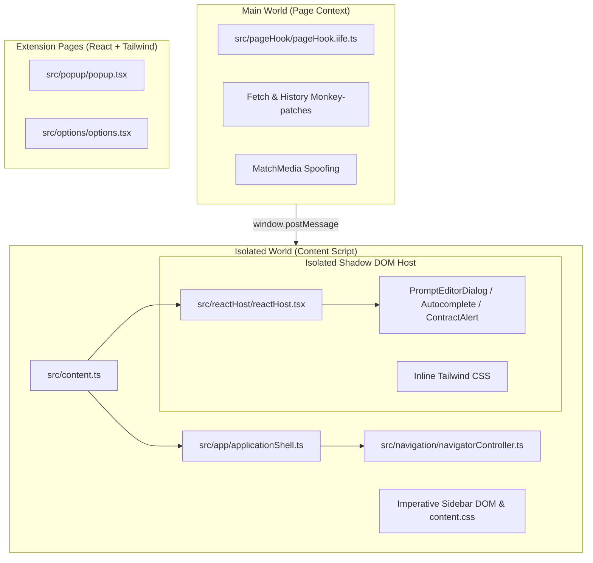
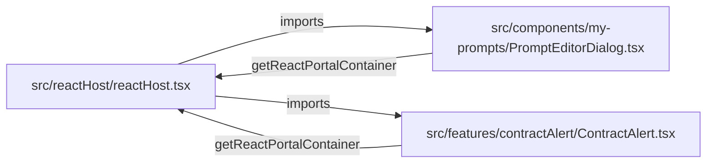
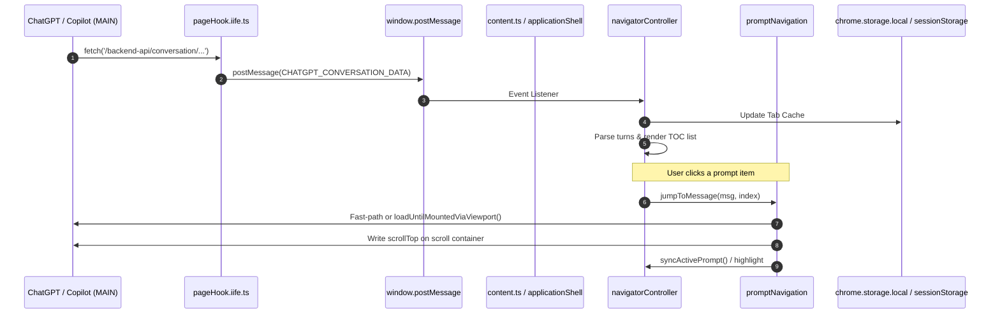
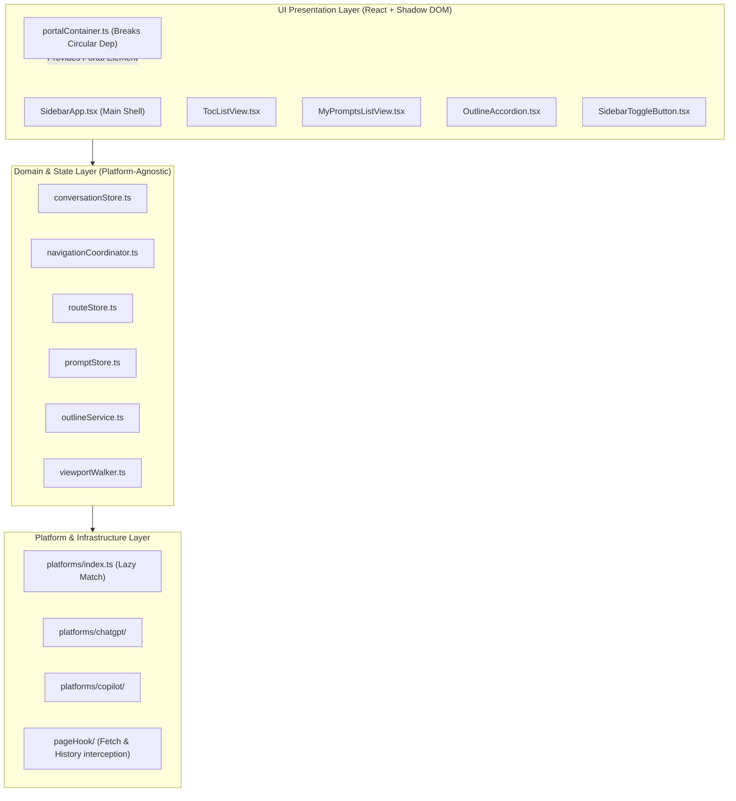

# Luna TOC — Codebase Audit and Refactoring Plan

**Document Version:** 1.0.0  
**Target Project:** LunaTOC Chrome Extension (`luna-toc` v1.11.5)  
**Date of Audit:** October 2026  
**Auditor:** Principal Codebase Architect  
**Status:** PROPOSED — Pending User Approval

---

## 1. Executive Summary

### 1.1 Context and Scope
LunaTOC is a Manifest V3 Chrome Extension providing a prompt Table of Contents (TOC), outline generator, and custom prompt library ("My Prompts") for AI chat platforms, primarily ChatGPT (with architectural provisions for Microsoft Copilot). The source consists of **19,290 lines of code** across TypeScript, CSS, HTML, and React components.

This audit evaluated the complete codebase for structural complexity, module coupling, state fragmentation, dead code, test coverage, and platform abstraction conformance.

### 1.2 Key Audit Findings
1. **Navigation Architecture Duality and Background Resource Waste (P0):**
   The codebase contains two competing navigation engines. Approximately **1,850+ lines of code** across `virtualSearchController.ts`, `virtualSearchPlanner.ts`, `virtualSearchMachine.ts`, `relativeSearchPlanner.ts`, `visiblePositionResolver.ts`, and fingerprint matchers implement an adaptive virtual search algorithm that is **completely disconnected** from live navigation. Live prompt jumps actually execute through `loadUntilMountedViaViewport` in `promptNavigation.ts` using `mountQueue.ts`. Despite this disconnection, `navigatorController.ts` and `renderedFingerprintCollector.ts` continue to run asynchronous SHA-256 fingerprint generation and a continuous `MutationObserver` on `document.body`, consuming CPU and memory on every page mutation for data that is never used.
2. **Platform Abstraction Breach (P0):**
   Although Architectural Decision Record 11 ([ADR 11](file:///Users/leo/Projects/chrome-plugins/luna-toc/docs/DECISIONS.md#adr-11-platform-abstraction-interface)) introduced a `Platform` interface to decouple host-specific selectors and communication, supposedly generic navigation modules (`src/navigation/jump/outline.ts`, `src/navigation/jump/promptNavigation.ts`, `src/navigation/jump/mountQueue.ts`, and `src/navigation/navigatorController.ts`) contain hardcoded ChatGPT-specific selectors such as `[data-chatgpt-search-unit-key$=":user"]` and `data-chatgpt-search-message-ids`.
3. **Monolithic "God Objects" Exceeding 1,000 Lines (P1):**
   - [`src/styles/content.css`](file:///Users/leo/Projects/chrome-plugins/luna-toc/src/styles/content.css) (1,119 lines): A single global stylesheet combining theme tokens, sidebar chrome, tooltips, modals, toggle buttons, and search inputs.
   - [`src/navigation/jump/promptNavigation.ts`](file:///Users/leo/Projects/chrome-plugins/luna-toc/src/navigation/jump/promptNavigation.ts) (1,097 lines): Mixes scroll clamping, MutationObserver debouncing, multi-attempt viewport walking, fast-path checks, edge jumps, settling loops, and debug console visualization.
   - [`src/navigation/navigatorController.ts`](file:///Users/leo/Projects/chrome-plugins/luna-toc/src/navigation/navigatorController.ts) (1,074 lines): A monolithic stateful singleton coordinating conversation fetching, history routes, fingerprint indexing, IntersectionObserver visibility, DOM list rendering, item click handling, and status badges.
   - Sibling modules [`outline.ts`](file:///Users/leo/Projects/chrome-plugins/luna-toc/src/navigation/jump/outline.ts) (919 lines) and [`promptLibrary.ts`](file:///Users/leo/Projects/chrome-plugins/luna-toc/src/features/myPrompts/promptLibrary.ts) (786 lines) exhibit similar multi-responsibility sprawl.
4. **Fragile Module Evaluation and Circular Dependencies (P0):**
   - Top-level evaluation of `getActivePlatform()` at module import time in [`sidebarVisibility.ts`](file:///Users/leo/Projects/chrome-plugins/luna-toc/src/features/sidebarVisibility.ts) and [`navigatorController.ts`](file:///Users/leo/Projects/chrome-plugins/luna-toc/src/navigation/navigatorController.ts) crashes test environments and non-host origins.
   - Confirmed circular dependencies exist between `reactHost.tsx` <-> `PromptEditorDialog.tsx` and `reactHost.tsx` <-> `ContractAlert.tsx`.
5. **Test Suite Drift and Typecheck Failures (P0):**
   - `npm run typecheck` fails with 8 errors in `test/navigation/jump/promptNavigationStrategy.test.ts`.
   - `npm test` fails 10 unit tests across 4 test suites because tests were written against obsolete DOM fixture structures (`data-message-author-role` vs `data-chatgpt-search-unit-key`) or removed option properties.

---

## 2. Current Architecture

### 2.1 Execution Environments and Boundaries

LunaTOC operates across three distinct Chrome execution boundaries:



1. **MAIN World (`src/pageHook/`):**
   - Injected via Manifest V3 `world: "MAIN"` at `document_start`.
   - Intercepts `window.fetch` to extract initial conversation trees, intercept paginated backfill responses, and capture real-time outgoing prompts.
   - Patches `history.pushState` and `history.replaceState` for instantaneous SPA navigation events.
   - Proxies `window.matchMedia` to force ChatGPT to retain wide-desktop layout trees during split-screen usage.
   - Communicates with the Isolated World exclusively through platform-namespaced `window.postMessage` channels.
2. **ISOLATED World (`src/content.ts`, `src/app/`, `src/navigation/`, `src/features/`):**
   - Content script entry initializing the application shell and mounting legacy imperative DOM elements directly into `document.body`.
   - Houses the sidebar resizer, navigator list, floating toggle button, and tooltips.
   - Manages state across `sessionStorage` (transient UI/pin states) and `chrome.storage.local` (saved prompts, theme preferences).
3. **Shadow DOM Boundary (`src/reactHost/`):**
   - Mounts a Shadow Root (`#luna-toc-react-host`) to contain modern React components (`@base-ui/react`, Radix-style UI, Tailwind v4).
   - Injects compiled Tailwind styles inline to prevent CSS contamination of the host application.

### 2.2 Host Abstraction (`src/platforms/`)

Introduced in ADR 11:
- [`Platform`](file:///Users/leo/Projects/chrome-plugins/luna-toc/src/platforms/platformInterface.ts): Contract defining `pageHook`, `navigation`, `routing`, `contentCapture`, `diagnostics`, `config`, and `messages`.
- [`getActivePlatform(host)`](file:///Users/leo/Projects/chrome-plugins/luna-toc/src/platforms/index.ts): Host detection function checking `window.location.host` against registered platform URL patterns.
- `src/platforms/chatgpt/`: Concrete implementation wrapping ChatGPT modules.
- `src/platforms/copilot/`: Stub implementation throwing placeholder errors.

---

## 3. Codebase Complexity Report

### 3.1 Line Count Inventory

| Line Count Range | File Count | Representative Files |
| :--- | :--- | :--- |
| **> 1,000 LOC** | 3 files | `src/styles/content.css` (1,119), `src/navigation/jump/promptNavigation.ts` (1,097), `src/navigation/navigatorController.ts` (1,074) |
| **500 – 1,000 LOC** | 6 files | `src/navigation/jump/outline.ts` (919), `src/features/myPrompts/promptLibrary.ts` (786), `src/navigation/jump/virtualSearchController.ts` (704), `src/navigation/fingerprint/segments.ts` (614), `src/features/myPrompts/promptAutocomplete.ts` (605), `src/platforms/chatgpt/virtualSearchAdapter.ts` (565) |
| **250 – 500 LOC** | 8 files | `src/navigation/jump/navigationAnchorStore.ts` (456), `src/config/config.ts` (421), `src/platforms/platformInterface.ts` (383), `src/features/tooltip.ts` (354), `src/features/sidebarVisibility.ts` (289), `src/navigation/jump/virtualSearchPlanner.ts` (285), `src/navigation/jump/visiblePositionResolver.ts` (269), `src/features/sidebar/sidebarController.ts` (260) |
| **100 – 250 LOC** | 22 files | `navigationSnapshotStore.ts` (253), `applicationShell.ts` (247), `matcher.ts` (220), `message.ts` (214), `SidebarToggleButton.ts` (212), `ContractAlert.tsx` (168), `pageHook.iife.ts` (163), etc. |
| **< 100 LOC** | 45+ files | Smaller UI components, utilities, types, stubs, and icons. |

### 3.2 High-Complexity Functions and Classes

1. **`navigatorController` singleton closure** ([`navigatorController.ts#L97-L1061`](file:///Users/leo/Projects/chrome-plugins/luna-toc/src/navigation/navigatorController.ts#L97-L1061)):
   Encapsulates 20+ pieces of mutable module-level state, 35 internal functions, postMessage event listeners, route reset coordinators, and complex DOM rendering routines (`render()` and `createNavigatorItem()`).
2. **`loadUntilMountedViaViewport()`** ([`promptNavigation.ts#L189-L373`](file:///Users/leo/Projects/chrome-plugins/luna-toc/src/navigation/jump/promptNavigation.ts#L189-L373)):
   184-line asynchronous loop orchestrating DOM inspection, viewport distance calculations, `scrollTop` manipulation, and MutationObserver synchronization with multiple heuristics.
3. **`renderMyPrompts()`** ([`promptLibrary.ts#L594-L786`](file:///Users/leo/Projects/chrome-plugins/luna-toc/src/features/myPrompts/promptLibrary.ts#L594-L786)):
   192 lines of raw imperative string concatenation (`innerHTML`), manual event binding, empty state handling, and inline SVG injection.
4. **`extractHeadingOutline()`** ([`outline.ts#L733-L775`](file:///Users/leo/Projects/chrome-plugins/luna-toc/src/navigation/jump/outline.ts#L733-L775)):
   Deeply nested DOM traversal inspecting Markdown containers, computing occurrence indices, and filtering out code block headings.
5. **`handleTextareaInput()` and caret range math** ([`promptAutocomplete.ts#L171-L470`](file:///Users/leo/Projects/chrome-plugins/luna-toc/src/features/myPrompts/promptAutocomplete.ts#L171-L470)):
   Direct manipulation of browser `Selection` and `Range` objects to measure pixel coordinates of trigger symbols (`//` or `#`) within a contenteditable element.

### 3.3 Circular Dependencies

Analysis of the import graph using AST traversal identified **2 active circular dependency chains**:



- **Chain 1:** `src/reactHost/reactHost.tsx` -> `src/components/my-prompts/PromptEditorDialog.tsx` -> `src/reactHost/reactHost.tsx`
- **Chain 2:** `src/reactHost/reactHost.tsx` -> `src/features/contractAlert/ContractAlert.tsx` -> `src/reactHost/reactHost.tsx`

**Root Cause:** `reactHost.tsx` acts simultaneously as the **composition root** (mounting all dialogs into React) and as the **service provider** (exporting `getReactPortalContainer()`).

### 3.4 Disconnected Code / Architecture Mismatch

A critical finding of this audit is that **~1,850+ lines of navigation code are completely bypassed in production**:
- [`virtualSearchController.ts`](file:///Users/leo/Projects/chrome-plugins/luna-toc/src/navigation/jump/virtualSearchController.ts) (704 lines)
- [`virtualSearchPlanner.ts`](file:///Users/leo/Projects/chrome-plugins/luna-toc/src/navigation/jump/virtualSearchPlanner.ts) (285 lines)
- [`visiblePositionResolver.ts`](file:///Users/leo/Projects/chrome-plugins/luna-toc/src/navigation/jump/visiblePositionResolver.ts) (269 lines)
- [`matcher.ts`](file:///Users/leo/Projects/chrome-plugins/luna-toc/src/navigation/fingerprint/matcher.ts) (220 lines)
- [`relativeSearchPlanner.ts`](file:///Users/leo/Projects/chrome-plugins/luna-toc/src/navigation/jump/relativeSearchPlanner.ts) (162 lines)
- [`segmentMatcher.ts`](file:///Users/leo/Projects/chrome-plugins/luna-toc/src/navigation/fingerprint/segmentMatcher.ts) (115 lines)
- [`virtualSearchMachine.ts`](file:///Users/leo/Projects/chrome-plugins/luna-toc/src/navigation/jump/virtualSearchMachine.ts) (101 lines)

*Evidence:* In `promptNavigation.ts#L684-L770`, `jumpToMessage()` routes directly to `jumpWithIndependentVirtualNavigation()`. That function performs a fast-path check (`findRenderedChatGptPrompt`) and, if unmounted, executes `loadUntilMountedViaViewport()`. The function `searchVirtualPrompt` from `virtualSearchController.ts` is **never imported or called** anywhere in `src/`. It is only referenced in unit tests and unused type declarations.

*Consequence:* `navigatorController.ts` still builds fingerprint indexes and derived segments via `buildFingerprintIndex` and `buildDerivedSegmentIndex`, and `renderedFingerprintCollector.ts` still listens to all DOM mutations on `document.body` to create observed SHA-256 hashes. All this data is placed in `navigationSnapshotStore`, passed into `promptNavigation.ts`, and **promptly ignored**. This represents a continuous, measurable CPU and memory leak on every ChatGPT conversation tab.

### 3.5 Test Suite Status & Coverage Gaps

Running automated test commands produced the following verified results:
- **`npm run build`**: PASSES (Vite + CRXJS produces valid bundle in `dist/`).
- **`npm run typecheck`**: FAILS with 8 TypeScript errors in `test/navigation/jump/promptNavigationStrategy.test.ts`.
- **`npm test`**: FAILS with 10 test failures across 4 files (34 test files pass, 4 test files fail).

#### Breakdown of Test Failures:
1. `test/navigation/jump/promptNavigationStrategy.test.ts` (4 test failures + 8 TS errors):
   Tests reference `getNativePromptButtons`, which was removed from `PromptNavigationOptions` during the ADR 11 refactor, and test legacy native navigation branches that were disabled in `promptNavigation.ts#L692`.
2. `test/navigation/jump/outline.test.ts` (2 test failures):
   Test fixture creates DOM nodes with obsolete attributes `data-message-author-role="user"` and `data-message-id="prompt-a"`, whereas `outline.ts#L633` now queries `[data-chatgpt-search-unit-key$=":user"]` and reads `data-chatgpt-search-message-ids`.
3. `test/platforms/chatgpt/virtualSearchAdapter.test.ts` (2 test failures):
   Same root cause as `outline.test.ts` (test fixture uses outdated DOM attribute names).
4. `test/platforms/chatgpt/renderedFingerprintCollector.test.ts` (2 test failures):
   Async timing issue where fake timer advance (`vi.advanceTimersByTimeAsync`) fails to flush microtask queue for jsdom MutationObserver callbacks.

---

## 4. Large File Analysis

### 4.1 `src/styles/content.css` (1,119 lines)
- **Current Responsibilities:** Contains all CSS for the sidebar, top bar, resize handle, floating drag button, TOC list items, prompt status drawers, search input, child outline hierarchies, My Prompts list, sort bars, modals, preview tooltips, and button tooltips.
- **Structural Problems:**
  - Injected directly into the host page's global stylesheet cascade (`world: "ISOLATED"` but affects `document.head`).
  - High specificity rules and global selectors risk colliding with host page styles or future host updates.
  - Mixes CSS Custom Property tokens (`:root`, `html[data-theme='dark']`) with component-specific layouts.
  - Changes to one feature's CSS can unintentionally break layout in another due to lack of scoping.

### 4.2 `src/navigation/jump/promptNavigation.ts` (1,097 lines)
- **Current Responsibilities:**
  - Low-level scroll math (`clampScrollTo`).
  - DOM MutationObserver synchronization (`waitForDomChange`, `waitForMount`, `settleOnce`).
  - Step-by-step viewport walking (`loadUntilMountedViaViewport`).
  - Target finding and queue indexing (`computeDirectionTowardTarget`, `nearestMountedTo`).
  - Fast-path prompt resolution.
  - Page-edge jumps (`jumpToConversationEdge`, `jumpToAbsoluteEdge`, `retryEdgeUntilSettled`).
  - Highlight and scroll-into-view coordination (`scrollToMatchedElement`, `highlightWhenVisible`).
  - Console visual diagnostics (`logMountedPromptViz`).
- **Structural Problems:**
  - Violates Single Responsibility Principle: coordinates low-level DOM mutation observation, scrolling animation, mathematical step heuristics, and high-level navigation entry points.
  - Contains hardcoded host selectors (`[data-chatgpt-search-unit-key$=":user"]`), breaking the platform abstraction.
  - Contains commented-out/dead legacy branches ([`promptNavigation.ts#L692-L701`](file:///Users/leo/Projects/chrome-plugins/luna-toc/src/navigation/jump/promptNavigation.ts#L692-L701)).

### 4.3 `src/navigation/navigatorController.ts` (1,074 lines)
- **Current Responsibilities:**
  - Manages active conversation messages and cache maps (`conversationMessages`, `cachedConversations`).
  - Coordinates postMessage conversation stream ingestion from the page hook.
  - Handles route change notifications and resets (`syncRouteState`, `resetStateForCurrentRoute`).
  - Builds fingerprint and segment indices via `navigationSnapshotStore`.
  - Sets up and runs `IntersectionObserver` on visible user messages to update the TOC cursor.
  - Generates the imperative DOM elements for the TOC list (`render()`, `createNavigatorItem()`).
  - Coordinates status bar state (`setSidebarStatus`).
- **Structural Problems:**
  - God object acting as controller, store, presenter, and event dispatcher simultaneously.
  - Top-level evaluation of `getActivePlatform()` at line 101 runs immediately upon module import.
  - Hardcoded ChatGPT selectors (`[data-chatgpt-search-unit-key$=":user"]`, `data-chatgpt-search-message-ids`) at lines 580, 605, 618.

### 4.4 `src/navigation/jump/outline.ts` (919 lines)
- **Current Responsibilities:**
  - Extracts headings from Assistant response Markdown containers (`extractHeadingOutline`).
  - Manages outline cache validity per prompt message ID (`getReusablePromptOutline`, `invalidatePromptOutline`).
  - Schedules debounced outline builds (`scheduleBuild`, `runBuild`).
  - Creates and manages prompt list item DOM elements (`createPromptItem`, `resetPromptItems`).
  - Renders the sidebar status pill and jumping dots animation (`setSidebarStatus`, `buildJumpingDotsElement`).
  - Handles outline accordion expansion/collapse (`collapseAll`, `togglePromptOutline`).
  - Dispatches outline heading click navigation (`handleOutlineItemClick`).
- **Structural Problems:**
  - Deeply mixes domain logic (extracting heading hierarchies from AST/DOM) with UI widget rendering (jumping dots, status drawer, buttons) and navigation execution.
  - Hardcodes ChatGPT selectors (`[data-chatgpt-search-unit-key$=":assistant"]`, `data-chatgpt-search-message-ids`).

### 4.5 `src/features/myPrompts/promptLibrary.ts` (786 lines)
- **Current Responsibilities:**
  - Interacts with Chrome storage for prompt persistence (`getMyPrompts`, `saveMyPrompts`).
  - Parses and serializes prompts to Markdown format for import/export (`formatPromptsAsMarkdown`, `parseMarkdownPrompts`).
  - Sorts prompt arrays by title and date (`sortMyPrompts`).
  - Copies prompt content to clipboard with UI feedback.
  - Renders the legacy modal dialog for confirmations (`showPromptModal`).
  - Imperatively builds and renders the My Prompts sidebar list and sort bar via `innerHTML` string templates.
- **Structural Problems:**
  - High cognitive load: storage logic, serialization algorithms, clipboard I/O, and DOM generation all reside in one file.
  - Bypasses React: While new prompts use `PromptEditorDialog.tsx`, the main prompt list still uses fragile imperative HTML concatenation.

---

## 5. Dependency Analysis

### 5.1 System Communication and State Flow



### 5.2 Shared State and Side Effects

| State Store | Key / Target | Managed In | Risks / Lifecycle |
| :--- | :--- | :--- | :--- |
| `sessionStorage` | `chatToc:marks:<convKey>` | `promptMark.ts` | Scoped to browser tab. Resets on tab close. |
| `sessionStorage` | `chatTocSidebarPinned` | `sidebarVisibility.ts` | Tab-scoped. Loaded synchronously on page mount. |
| `sessionStorage` | `chatTocToggleButtonPosition` | `SidebarToggleButton.ts` | Pixel coordinates of floating button. Tab-scoped. |
| `chrome.storage.local` | `chatToc:myPrompts` | `promptStore.ts` | Persistent user data. Must preserve schema (`id`, `title`, `content`, `updatedAt`). |
| `chrome.storage.local` | `chatToc:myPromptsUsage` | `promptUsageStore.ts` | Autocomplete ranking metrics (`count`, `lastUsedAt`). |
| `chrome.storage.local` | `chatToc:theme` | `themeSettings.ts` | Shared between Popup and Content Script. |
| `chrome.storage.local` | `luna:chatgpt:runtimeConfig`| `config.ts` | Developer overrides for contract slots. |
| `chrome.storage.local` | `chatToc:navigationAnchors` | `navigationAnchorStore.ts` | 30-day LRU anchor cache. Currently decoupled from live jumps. |
| DOM Mutation | `window.fetch`, `history` | `pageHook.iife.ts` | Monkey-patched in MAIN world. Must not alter native promise resolution. |
| DOM Mutation | `document.body` | `applicationShell.ts` | Injects sidebar, toggle button, tooltips, and Shadow host. |

---

## 6. Proposed Architecture

### 6.1 Architectural Principles
1. **Separation of Concerns:** Pure business logic (sorting, parsing, searching) must have zero DOM dependencies.
2. **Platform Abstraction Integrity:** No generic module may contain host-specific CSS selectors or API paths.
3. **Lazy Evaluation:** No module may perform host detection or environment lookups at import time.
4. **Unified Component Model:** Deprecate imperative DOM string templates in favor of React components rendered inside the isolated Shadow Root.
5. **Elimination of Dead Weight:** Reconcile navigation engines; remove or isolate unused virtual search machinery to eliminate background CPU cycles.

### 6.2 Target Architecture Diagram



---

## 7. File-by-File Refactoring Recommendations

### 7.1 `src/navigation/jump/promptNavigation.ts` (1,097 LOC -> Split into 3 modules)
- **Problem:** Combines viewport walking loops, scroll math, fast-path resolution, edge jumping, and console diagnostics.
- **Proposed Split:**
  1. [`src/navigation/jump/viewportWalker.ts`](file:///Users/leo/Projects/chrome-plugins/luna-toc/src/navigation/jump/viewportWalker.ts) (~250 LOC):
     - Contains `loadUntilMountedViaViewport`, `computeDirectionTowardTarget`, `nearestMountedTo`, `waitForDomChange`, and `clampScrollTo`.
     - Pure focus: walking the scroll container step-by-step until an element mounts.
  2. [`src/navigation/jump/edgeNavigation.ts`](file:///Users/leo/Projects/chrome-plugins/luna-toc/src/navigation/jump/edgeNavigation.ts) (~150 LOC):
     - Contains `jumpToConversationEdge`, `jumpToAbsoluteEdge`, `retryEdgeUntilSettled`, and `findFirstPromptInTopBand`.
  3. [`src/navigation/jump/promptNavigation.ts`](file:///Users/leo/Projects/chrome-plugins/luna-toc/src/navigation/jump/promptNavigation.ts) (reduced to ~200 LOC):
     - High-level coordinator: `jumpToMessage()`, `jumpToPromptIndex()`, lock management, fast-path resolution, and visual highlight triggering.
- **Communication:** `promptNavigation.ts` delegates to `viewportWalker.ts` and `edgeNavigation.ts`. All host selectors are read via `platform.config.selectors`.

### 7.2 `src/navigation/navigatorController.ts` (1,074 LOC -> Split into 4 modules)
- **Problem:** God object combining conversation state, route listening, fingerprint triggering, IntersectionObserver, and TOC DOM rendering.
- **Proposed Split:**
  1. [`src/navigation/state/conversationStore.ts`](file:///Users/leo/Projects/chrome-plugins/luna-toc/src/navigation/state/conversationStore.ts) (~200 LOC):
     - Holds active messages, caches per conversation key, and message normalization.
     - Subscribable store pattern (`subscribe(callback)`).
  2. [`src/navigation/tracking/activePromptTracker.ts`](file:///Users/leo/Projects/chrome-plugins/luna-toc/src/navigation/tracking/activePromptTracker.ts) (~180 LOC):
     - Owns `IntersectionObserver` on mounted user messages and active prompt index calculations.
     - Emits `onActivePromptChanged(index)`.
  3. [`src/navigation/ui/tocListRenderer.ts`](file:///Users/leo/Projects/chrome-plugins/luna-toc/src/navigation/ui/tocListRenderer.ts) (~300 LOC):
     - Manages item element creation, truncation checking, tooltip wiring, and list updates.
  4. [`src/navigation/navigatorController.ts`](file:///Users/leo/Projects/chrome-plugins/luna-toc/src/navigation/navigatorController.ts) (reduced to ~250 LOC):
     - Orchestrator listening to platform postMessage events and delegating to stores and renderers.
- **Elimination of Resource Leak:** Disconnect `renderedFingerprintCollector` and `buildFingerprintIndex` from the default navigation path, saving significant idle CPU and memory.

### 7.3 `src/navigation/jump/outline.ts` (919 LOC -> Split into 3 modules)
- **Problem:** Mixes Markdown heading DOM extraction, cache invalidation, sidebar status indicators (jumping dots), prompt item UI, and click handling.
- **Proposed Split:**
  1. [`src/navigation/outline/headingExtractor.ts`](file:///Users/leo/Projects/chrome-plugins/luna-toc/src/navigation/outline/headingExtractor.ts) (~180 LOC):
     - Pure extraction: parses Markdown containers into `OutlineEntry[]`.
  2. [`src/navigation/outline/outlineCache.ts`](file:///Users/leo/Projects/chrome-plugins/luna-toc/src/navigation/outline/outlineCache.ts) (~150 LOC):
     - Manages cached outline descriptors and invalidation rules.
  3. [`src/navigation/outline/outlineView.ts`](file:///Users/leo/Projects/chrome-plugins/luna-toc/src/navigation/outline/outlineView.ts) (~250 LOC):
     - Renders outline accordion lists, toggle buttons, and handles outline item clicks.
  4. [`src/navigation/ui/sidebarStatus.ts`](file:///Users/leo/Projects/chrome-plugins/luna-toc/src/navigation/ui/sidebarStatus.ts) (~100 LOC):
     - Owns `setSidebarStatus()`, status drawer animations, and jumping dots.

### 7.4 `src/features/myPrompts/promptLibrary.ts` (786 LOC -> Split into 3 modules)
- **Problem:** Mixes persistence, Markdown serialization, sorting, clipboard actions, modal dialogs, and imperative DOM list rendering.
- **Proposed Split:**
  1. [`src/features/myPrompts/promptSerializer.ts`](file:///Users/leo/Projects/chrome-plugins/luna-toc/src/features/myPrompts/promptSerializer.ts) (~120 LOC):
     - Pure Markdown parser and formatter for import/export (`formatPromptsAsMarkdown`, `parseMarkdownPrompts`).
  2. [`src/features/myPrompts/promptSorter.ts`](file:///Users/leo/Projects/chrome-plugins/luna-toc/src/features/myPrompts/promptSorter.ts) (~60 LOC):
     - Pure sorting logic (`sortMyPrompts`, sort modes).
  3. [`src/features/myPrompts/promptLibrary.ts`](file:///Users/leo/Projects/chrome-plugins/luna-toc/src/features/myPrompts/promptLibrary.ts) (reduced to ~250 LOC):
     - Manages storage operations, export/import file prompts, and clipboard actions.

### 7.5 `src/reactHost/reactHost.tsx` (Break Circular Dependencies)
- **Problem:** Circular imports between `reactHost.tsx` and child dialogs.
- **Proposed Refactor:**
  - Create [`src/reactHost/portalContainer.ts`](file:///Users/leo/Projects/chrome-plugins/luna-toc/src/reactHost/portalContainer.ts) (~30 LOC).
  - Holds `let portalContainer: HTMLDivElement | null = null;` and exports `getReactPortalContainer()` and `setReactPortalContainer()`.
  - Both `reactHost.tsx` and child components (`PromptEditorDialog.tsx`, `ContractAlert.tsx`) import from `portalContainer.ts`, breaking the cycle.

### 7.6 Top-Level `getActivePlatform()` Elimination
- **Problem:** [`sidebarVisibility.ts#L8`](file:///Users/leo/Projects/chrome-plugins/luna-toc/src/features/sidebarVisibility.ts#L8) and [`navigatorController.ts#L101`](file:///Users/leo/Projects/chrome-plugins/luna-toc/src/navigation/navigatorController.ts#L101) evaluate `getActivePlatform()` at module import time.
- **Proposed Refactor:**
  - In `sidebarVisibility.ts`: read `getActivePlatform().pageHook.messages.setWidthSpoof` lazily inside `initializeSidebarVisibility()`.
  - In `navigatorController.ts`: instantiate collectors lazily inside `init()` or `attach()`.

---

## 8. Prioritised Refactoring Roadmap

### Phase P0 — Critical Stabilization & Defect Remediation
*Objective: Restore test health, remove circular dependencies, eliminate runtime crashes, and resolve the navigation architecture leak.*

| Task ID | Task Description | Expected Benefit | Complexity | Risk | Dependencies | Required Tests |
| :--- | :--- | :--- | :--- | :--- | :--- | :--- |
| **P0.1** | Fix test suite breakages and TypeScript errors in `promptNavigationStrategy.test.ts`, `outline.test.ts`, and `virtualSearchAdapter.test.ts`. | Green test suite and typecheck; prevents developer confusion. | Low | None | None | `npm run typecheck`, `npm test` |
| **P0.2** | Make `getActivePlatform()` lazy in `sidebarVisibility.ts` and `navigatorController.ts`. | Eliminates import-time crashes in non-host environments and tests. | Low | None | None | Unit tests importing these modules. |
| **P0.3** | Break circular dependencies in `reactHost.tsx` by extracting `portalContainer.ts`. | Clean acyclic dependency graph; prevents module initialization bugs. | Low | None | None | React Shadow host mount tests. |
| **P0.4** | Formalize active navigation architecture: isolate unused virtual search modules (~1,850 LOC) and disable continuous `MutationObserver` fingerprinting on `document.body`. | Eliminates significant continuous CPU/memory consumption on every conversation tab. | Medium | Low | None | Navigation benchmark on long chats. |

### Phase P1 — High-Value Maintainability Improvements
*Objective: Deconstruct monolithic God objects, eliminate code duplication, and enforce platform abstraction boundaries.*

| Task ID | Task Description | Expected Benefit | Complexity | Risk | Dependencies | Required Tests |
| :--- | :--- | :--- | :--- | :--- | :--- | :--- |
| **P1.1** | Remove hardcoded host selectors (`[data-chatgpt-search-unit-key$=":user"]`) from `outline.ts`, `promptNavigation.ts`, `mountQueue.ts`, and `navigatorController.ts` into `platform.config.selectors`. | True multi-platform readiness; changes in ChatGPT DOM only require updating adapter config. | Medium | Low | P0.1 | Adapter and navigation tests. |
| **P1.2** | Decompose `navigatorController.ts` (1,074 LOC) into `conversationStore.ts`, `activePromptTracker.ts`, and `tocListRenderer.ts`. | Testable individual units; separation of data ingestion from DOM presentation. | High | Medium | P0.2 | `test/navigation/` unit tests. |
| **P1.3** | Decompose `promptNavigation.ts` (1,097 LOC) into `viewportWalker.ts`, `edgeNavigation.ts`, and high-level coordinator. | Isolates complex viewport scrolling math; improves maintainability. | High | Medium | P1.1 | Jump navigation unit tests. |
| **P1.4** | Decompose `promptLibrary.ts` (786 LOC) into `promptSerializer.ts`, `promptSorter.ts`, and core library. | Pure logic modules tested without DOM/storage dependencies. | Medium | Low | None | My Prompts unit tests. |
| **P1.5** | Decompose `outline.ts` (919 LOC) into `headingExtractor.ts`, `outlineCache.ts`, and `sidebarStatus.ts`. | Decouples Markdown parsing from sidebar animation and DOM nodes. | Medium | Low | P1.1 | Outline extraction unit tests. |
| **P1.6** | Split `config.ts` (421 LOC) into compile-time tokens (`uiConfig.ts`) and runtime persistence (`platformRuntimeConfigStore.ts`). | Clear boundary between static tuning constants and Chrome storage keys. | Low | Low | None | Config unit tests. |

### Phase P2 — Modernization & Cleanup
*Objective: Modularize CSS, enhance UI maintainability, and clean up secondary components.*

| Task ID | Task Description | Expected Benefit | Complexity | Risk | Dependencies | Required Tests |
| :--- | :--- | :--- | :--- | :--- | :--- | :--- |
| **P2.1** | Split `src/features/tooltip.ts` (354 LOC) into `previewTooltip.ts` and `buttonTooltip.ts`. | Distinct lifecycle and positioning concerns; reduces file size. | Low | Low | None | Tooltip unit tests. |
| **P2.2** | Modularize `src/styles/content.css` (1,119 LOC) into semantic CSS files (`theme.css`, `sidebar.css`, `toggle.css`). | Easier style maintenance; prevents cascading regressions. | Medium | Low | None | Visual regression check. |
| **P2.3** | Decompose `promptAutocomplete.ts` (605 LOC) into caret positioning geometry, trigger parsing, and prompt ranking. | Testable caret measurement and query ranking logic. | Medium | Low | None | Autocomplete unit tests. |

---

## 9. Testing and Verification Strategy

### 9.1 Automated Test Execution Plan
Following any refactoring step, execute the standard verification triad:
```bash
npm run typecheck    # Verifies TypeScript typing across browser and Node configs
npm test             # Runs all Vitest test suites (target: 38 passed suites, 0 failures)
npm run build        # Confirms Vite + CRXJS builds valid production assets in dist/
```

### 9.2 Unit Test Modernization Checklist
1. Update `test/navigation/jump/outline.test.ts` fixtures to reflect `[data-chatgpt-search-unit-key$=":user"]` and `data-chatgpt-search-message-ids`.
2. Update `test/platforms/chatgpt/virtualSearchAdapter.test.ts` fixtures with current selector structure.
3. Update `test/navigation/jump/promptNavigationStrategy.test.ts` to test active `independent-virtual` navigation options.
4. Add pure logic tests for extracted modules (`headingExtractor`, `promptSerializer`, `viewportWalker`).

### 9.3 Manual Verification Protocol (Chrome Browser)
Because Chrome Extensions run in a live browser context, execute these manual tests by loading the generated `dist/` directory into Chrome (`chrome://extensions`):
1. **Initial Mount:** Open ChatGPT (`https://chatgpt.com`). Confirm the TOC sidebar mounts cleanly on the right edge with the floating toggle button.
2. **Conversation Loading:** Open a short chat (5 turns) and a long chat (100+ turns). Verify that all user prompts render with correct titles and count indicators.
3. **Jump Navigation:**
   - Click a prompt currently in the viewport (instant focus).
   - Click a prompt offscreen (smooth scrolling walk using `loadUntilMountedViaViewport`).
   - Click prompts in rapid succession mid-jump (confirm previous jump aborts cleanly without jitter).
4. **Child Outline Extraction:** Expand a prompt containing H2/H3 headings. Confirm the accordion expands and clicking a child heading scrolls to the assistant section.
5. **My Prompts & Autocomplete:**
   - Switch to My Prompts view. Add, edit, sort, and delete a template prompt.
   - In the ChatGPT composer, type `//` or `#`. Confirm the suggestion menu appears and selecting an item inserts the template.
6. **Edge Controls & Overlays:**
   - Test jump-to-top and jump-to-bottom buttons.
   - Open a full-screen image or media modal on ChatGPT; confirm LunaTOC surfaces temporarily yield z-index precedence.
7. **Theme Synchronization:** Toggle ChatGPT between Dark and Light mode. Confirm LunaTOC follows the host theme.

---

## 10. Risks and Compatibility Considerations

### 10.1 Preserving Storage Schema Compatibility
- The schema for `chatToc:myPrompts` in `chrome.storage.local` must remain strictly backwards-compatible:
  ```ts
  interface SavedPrompt {
    id: string;
    title: string;
    content: string;
    updatedAt: number;
  }
  ```
- Any refactoring must ensure no data migration or field alteration occurs that could cause user data loss.

### 10.2 Host DOM Volatility
- ChatGPT periodically modifies DOM classes, data attributes, and virtualization container hierarchy.
- **Mitigation:** Centralizing all host selectors in `src/platforms/chatgpt/` ensures that any future OpenAI frontend update can be addressed by modifying a single selector table rather than auditing dozens of scattered files.

### 10.3 Shadow DOM Style Encapsulation
- React UI components reside in a Shadow Root, but legacy components (`#luna-toc-sidebar`) reside directly in `document.body`.
- Refactoring must preserve the stacking context definitions in `APP_CONFIG.ui.stacking` so z-index layers remain synchronized between document DOM and Shadow DOM portals.

---

*Report prepared for user review. No source files have been modified.*
